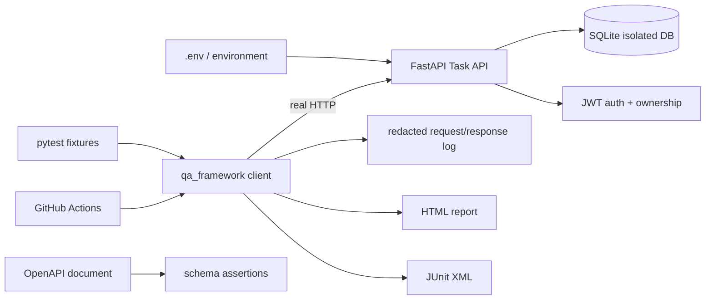

# Python API Test Automation Framework

A professional, self-contained QA automation portfolio project: a real REST API
(System Under Test) plus an HTTP-driven pytest framework that verifies it over
genuine network requests. Built for Mid-Level QA Automation Engineer / SDET
evidence — not a mock-only demo.

**Independence:** this is a self-directed portfolio project. It uses only local
synthetic test data and an in-process SQLite database; no external dataset or
third-party account is required.

## 1. Purpose

Show that the automation work is grounded in a working product: authentication,
authorization, persistence, validation and standardized errors are implemented in
FastAPI, then exercised through a reusable Requests-based client with logging,
reporting, contract checks and markers.

## 2. Tech stack

- **SUT:** Python 3.12, FastAPI, Pydantic v2, SQLite, PyJWT (HS256), Uvicorn.
- **Framework:** pytest, Requests, pytest-html, JSON Schema (jsonschema),
  Pydantic, Ruff, mypy.
- **Delivery:** GitHub Actions (3.12), Docker / Docker Compose.

## 3. Architecture



Details: [docs/ARCHITECTURE.md](docs/ARCHITECTURE.md).

## 4. Repository structure

```
app/                 FastAPI SUT (config, database, models, schemas, security, routers)
qa_framework/        Reusable client, settings, assertions, redacted logging, helpers
tests/
  api/               Auth, CRUD, negative and boundary HTTP scenarios
  contract/          OpenAPI and JSON Schema scenarios
  unit/              Framework utilities (no HTTP)
docs/                Architecture, test plan, cases, traceability, CI/CD, defect template
scripts/             PowerShell setup, test and quality-check scripts
.github/workflows/   CI with least-privilege permissions
```

## 5. Installation (Windows PowerShell)

```powershell
git clone https://github.com/yazanus94-dot/python-api-test-automation-framework.git
cd python-api-test-automation-framework
.\scripts\setup.ps1
```

`setup.ps1` creates `.venv`, installs both requirement files and copies
`.env.example` to `.env`. Edit `JWT_SECRET_KEY` before any non-local use.

Manual equivalent:

```powershell
python -m venv .venv
.\.venv\Scripts\Activate.ps1
pip install -r requirements.txt -r requirements-dev.txt
Copy-Item .env.example .env
```

## 6. API endpoints

| Method | Path | Auth | Purpose |
|---|---|---|---|
| GET | `/health` | no | Liveness |
| POST | `/api/v1/auth/token` | no | JWT token from username/password |
| GET | `/api/v1/tasks` | Bearer | Paginated list (`page`, `page_size`) |
| POST | `/api/v1/tasks` | Bearer | Create task |
| GET | `/api/v1/tasks/{task_id}` | Bearer | Read task (owner only) |
| PATCH | `/api/v1/tasks/{task_id}` | Bearer | Update task (owner only) |
| DELETE | `/api/v1/tasks/{task_id}` | Bearer | Delete task (204, owner only) |

Errors use a consistent `{"detail": ..., "code": ...}` envelope. Title limit 1–200,
description limit 1000, status enum `pending|in_progress|completed`.

## 7. Running tests

The suite starts the real API in a background Uvicorn thread with a temporary
SQLite database. No mocked HTTP responses are used.

```powershell
python -m pytest -v                       # all 52 scenarios
python -m pytest -m smoke -v              # 4 critical checks
python -m pytest -m "regression and not smoke" -v   # 48 regression checks
python -m pytest -m authentication -v     # 8
python -m pytest -m negative -v           # 16
python -m pytest -m contract -v           # 13
python -m pytest -m integration -v        # 11
python -m pytest -m unit -v               # 4
```

Markers are declared in `pyproject.toml`. `smoke` (4) and `regression and not
smoke` (48) are mutually exclusive and sum to the 52 unique scenarios; other
markers (authentication, negative, contract, integration, unit) overlap by
design. Each scenario is described in [docs/TEST_CASES.md](docs/TEST_CASES.md).

## 8. Test categories

- **Authentication:** valid/invalid login, missing credentials, invalid and
  expired tokens, missing Authorization header.
- **CRUD/persistence:** create, read, list, update, delete, HTTP persistence
  verification through a separate authenticated client, nonexistent IDs and
  cross-user 403. No test reads the SQLite file directly, so the same suite runs
  when API and tests are in different containers.
- **Negative:** invalid JSON, missing fields, wrong types, invalid status/IDs,
  unauthorized requests, unsupported methods and bad pagination.
- **Boundary:** title min/max, below-minimum/above-maximum, description maximum,
  pagination upper bound.
- **Contract:** live `/openapi.json`, expected paths, request/response schemas,
  required fields, content types and status codes — validated with JSON Schema.

## 9. Reports and diagnostic logging

`pyproject.toml` adds `--html=reports/report.html --junitxml=reports/junit.xml`
to every pytest run. Request/response diagnostics go to
`reports/api_test.log`; passwords, tokens and Bearer headers are replaced with
`***REDACTED***` before logging. Reports and logs are git-ignored.

## 10. CI/CD

[docs/CI_CD.md](docs/CI_CD.md). The quality job runs on Python 3.12: checkout →
setup-python → install → Ruff check → Ruff format check → mypy →
`pytest -m smoke` → `pytest -m "regression and not smoke"` → upload reports with
`if: always()`. A Docker job builds the image, validates Compose, starts the API
container, waits for health, runs the tests container against `http://api:8000`
with `USE_EXTERNAL_API=1`, and always tears down containers and volumes.
Permissions are `contents: read`.

## 11. Docker

```powershell
docker compose up --build api
docker compose run --rm tests
```

`api` serves port 8765 on the host; `tests` targets `http://api:8000` with
`USE_EXTERNAL_API=1` and writes reports to `./reports`. Compose syntax was
validated with `docker compose config`. Image build is **not verified locally**:
the Docker CLI is installed but the daemon was unavailable in this workspace.

## 12. Verification evidence (2026-11-23)

**Locally verified (Python 3.14.7, Windows 11):**

| Check | Result |
|---|---|
| `python -m pytest` | **52 passed, 0 failed** |
| `python -m pytest -m smoke` | **4 passed, 48 deselected** |
| `python -m pytest -m "regression and not smoke"` | **48 passed, 4 deselected** |
| `ruff check .` | **All checks passed!** |
| `ruff format --check .` | **24 files already formatted** |
| `mypy app qa_framework` | **Success: no issues found in 16 source files** |
| HTML + JUnit reports | generated in `reports/` |

**Docker verified locally:** only `docker compose config` (valid YAML). The
local Docker daemon was unavailable, so no local image build or container test
was executed. Docker build and test execution are verified by the GitHub Actions
Docker job instead.

**GitHub Actions verified:** Python 3.12 quality gates and the Docker
integration job; see the repository Actions tab for the latest run. Command-level
proof, including public commit and raw-file checks, is recorded in
[docs/PUBLIC_VERIFICATION.md](docs/PUBLIC_VERIFICATION.md).

## 13. Limitations

- Local verification used Python 3.14.7 because 3.12 is not installed here; the
  project declares 3.12+ and CI targets 3.12.
- Docker image build was not executed (daemon unavailable).
- JWT secret in `.env.example` is for local development only.
- No load testing, external IdP or production secret management.
- Reports/logs are generated artifacts and intentionally not committed.

## 14. Contributing and license

See [CONTRIBUTING.md](CONTRIBUTING.md) and [LICENSE](LICENSE).
