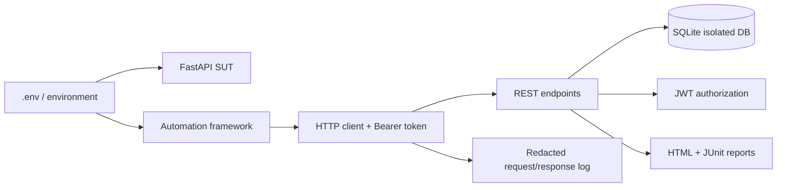

# Architecture

## System under test (SUT)

A FastAPI Task Management API backed by SQLite:

| Module | Responsibility |
|---|---|
| `app/main.py` | App assembly, `/health`, standardized validation and HTTP exception handlers |
| `app/config.py` | Environment-driven settings (read on each access for test isolation) |
| `app/database.py` | SQLite connection, schema and deterministic seeded users |
| `app/models.py` | Row → response mapping |
| `app/schemas.py` | Pydantic request/response models and field limits |
| `app/security.py` | PBKDF2 password hashing and HS256 JWT issue/validation |
| `app/routers/auth.py` | `POST /api/v1/auth/token` |
| `app/routers/tasks.py` | Authenticated CRUD, pagination and ownership enforcement |

## Automation framework

| Module | Responsibility |
|---|---|
| `qa_framework/settings.py` | Environment/.env configuration |
| `qa_framework/api_client.py` | Reusable GET/POST/PUT/PATCH/DELETE client with redacted diagnostics |
| `qa_framework/assertions.py` | Status, content-type, field, error-shape and JSON Schema assertions |
| `qa_framework/logging_config.py` | File logging with a credential-redacting filter |
| `qa_framework/helpers.py` | Redaction, test-data factory, health polling |

## Data and credential flow

Credentials never appear in logs: `redact()` masks password/token keys and
Bearer values, and the logging filter reapplies it to structured records.

## Isolation model

- Each pytest session starts a real Uvicorn server on port 8765 with a temporary
  SQLite database, so tests never touch developer data.
- `USE_EXTERNAL_API=1` targets an already-running API (used by Docker Compose).
- Every task is created through HTTP and deleted in fixture teardown, so tests
  are independent and repeatable.
